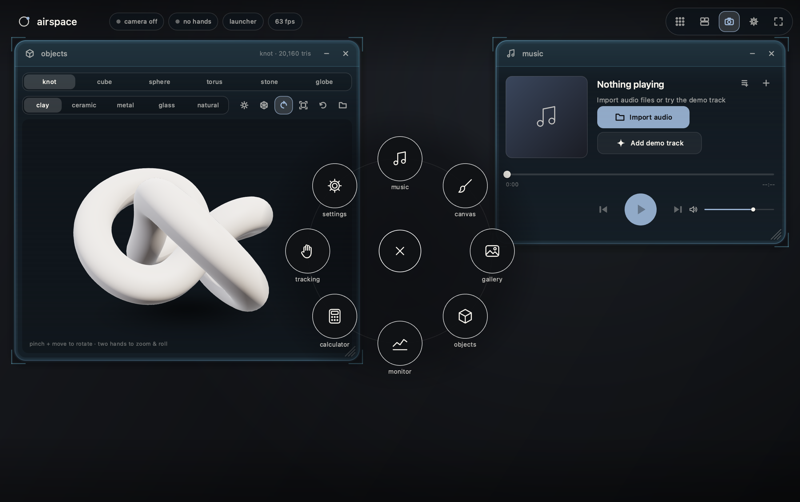
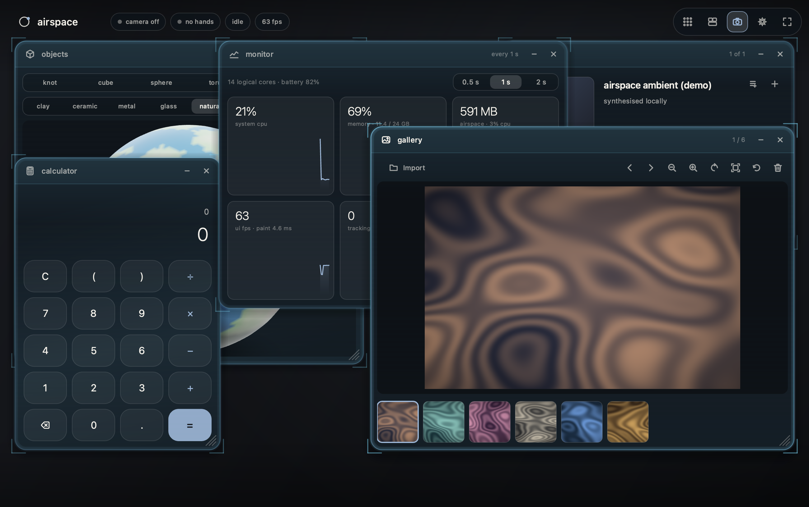
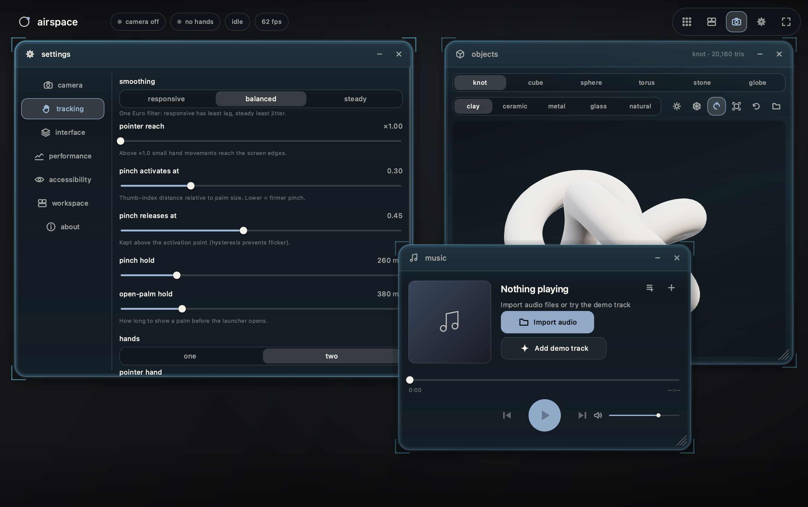
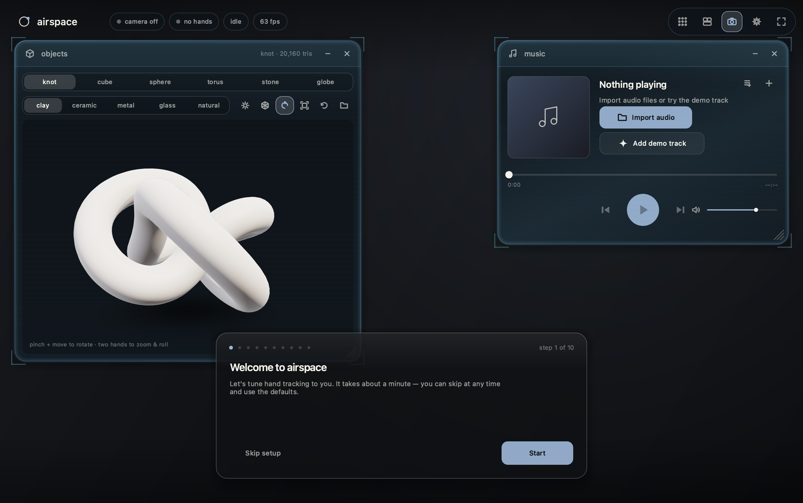

# airspace

**A gesture-controlled spatial desktop powered by computer vision.**



airspace turns an ordinary webcam into an input device. Your mirrored camera
feed becomes the backdrop of a workspace of floating glass windows; you point
with your index finger, pinch to click and grab, open your palm for the app
launcher, stretch two hands apart to resize, and draw in the air. Everything
runs on-device in Python — OpenCV for capture, MediaPipe for hand landmarks
and person segmentation, PySide6/Qt for the interface, ModernGL for 3D.

> Screenshots in this README were captured from the running application with
> `python -m airspace --screenshot …` (camera off, so the backdrop is the
> solid background). See [Testing status](#testing-status) for exactly what
> has and hasn't been verified with a physical webcam.

---

## Contents

- [Features](#features) · [Gesture guide](#gesture-guide) · [Installation](#installation) ·
  [Launching](#launching) · [Calibration](#calibration) · [Keyboard & mouse](#keyboard--mouse)
- [Architecture](#architecture) · [Performance](#performance) · [Testing](#testing) ·
  [Packaging](#packaging) · [Troubleshooting](#troubleshooting) · [Limitations](#known-limitations) · [Privacy](#privacy)

## Features

**Spatial workspace**
- Mirrored live webcam backdrop, or blurred / dimmed / solid backgrounds (tracking keeps running).
- Real window manager: open, close, focus, z-order, drag, edge/corner resize, two-hand stretch, minimise to a dock,
  restore, arrange, layout persistence, reset — all with mouse *and* hands.
- Holographic glass windows: the live room (and your hands) stay visible through the window background while
  the content stays solid; projected-light rim with a slight colour fringe, corner brackets, faint scanlines and
  a slow light sweep (off with reduced motion). Where windows overlap, the upper one shows the frosted room, never
  the text of the window beneath. Soft shadows, spring-based motion, selection lift and active-interaction glow.
- **Body & hand occlusion** with three modes: *balanced* (hands pass in front of windows, with a clear "lens" around
  the fingertip so the target stays readable), *cinematic* (the whole person in front of the UI), *clear*
  (UI always on top).
- **Smart placement**: new windows avoid your face, torso, the active-hand zone and other windows, preferring the
  edges. Windows never move on their own after that.
- Radial launcher (open palm, ⌘O, or the apps button), status pills, toasts, tracking-lost indicator.

**Mini-apps** (all functional)

| app | what it does |
|---|---|
| **music** | Import local audio, queue, play/pause/skip/seek, volume, album art from metadata, live spectrum from decoded audio (Qt `QAudioBufferOutput`), swipe to skip. A demo track is *synthesised locally* on request — no bundled music. |
| **canvas** | Air drawing: pinch on the surface to draw, smooth curves through samples, velocity-sensitive width, brush/eraser, 6 colours, 3 sizes, undo/redo (including clear), PNG export, project save/open, autosave. |
| **gallery** | Import images (read-only), thumbnails, next/previous, swipe navigation, pinch-pan, two-hand zoom + rotate, fit/reset, remove from gallery; images decode off the UI thread with an LRU cache. Procedural sample images on request. |
| **objects** | Real 3D viewport (ModernGL, 4× MSAA): knot, rounded cube, sphere, torus, low-poly stone, procedural globe. Materials (clay, ceramic, metal, glass, natural), 4 lighting rigs, wireframe overlay, soft contact shadow, inertia, auto-rotate, GLB/GLTF/OBJ/STL/PLY import via trimesh. |
| **monitor** | Real CPU, memory, process memory, battery (psutil) plus measured UI / camera / tracking fps and capture→display latency with sparklines; adjustable interval. |
| **calculator** | Large keys, keyboard input, live preview, history. A hand-written tokenizer + recursive-descent parser over `Decimal` — no `eval`. |
| **tracking** | Live landmark diagram (depth-coloured), handedness + model score, gesture, pinch ratio vs. thresholds, fingertip coordinates, pointer anchor, jitter (labelled as derived), pipeline timings, filter parameters; toggles for skeleton, labels, trail, pinch zones, segmentation mask, interaction region. |
| **settings** | Camera, tracking, interface, performance, accessibility, workspace, about — applied live, saved automatically. |

<p align="center">
  
  
</p>
<p align="center">
  
</p>

*All screenshots are real frames of the running app (camera off). No demo GIF/video is included yet —
record one with your webcam to show live hand tracking.*

## Gesture guide

| gesture | how | does |
|---|---|---|
| **point** | index finger out | moves the cursor, hovers controls |
| **pinch** | touch thumb and index tips | press; release to click. One pinch = one click. |
| **pinch + move** | keep pinching and move | drag windows (title bar), resize (corner grip), adjust sliders, draw, pan, rotate 3D |
| **pinch hold** | hold a pinch | the hold is recognised (≈0.26 s) for grab-style interactions |
| **open palm** | show a spread palm, hold still ≈0.4 s | opens the launcher (not while hovering a control or dragging; holding it longer never toggles it closed) |
| **fist** | close your hand ≈0.3 s | closes the launcher / cancels the current interaction |
| **two-hand stretch** | pinch a window's title bar, then pinch with the other hand and move apart | resizes the window; in gallery/objects it zooms (and rolls/rotates) |
| **swipe** | quick open-hand sweep | next/previous in gallery and music — ignored while dragging |

The cursor shows what's happening: a ring that tightens as your fingers approach (pinch preparation), a filled
ring while pressed, a ripple on click, an orange arc while an open palm is being held, a green arc for dwell-click.

## Installation

Requires **Python 3.11+** (verified on 3.15.2, earlier on 3.14.0) and a webcam.

```bash
git clone <this repository> airspace && cd airspace
python3 -m venv .venv
source .venv/bin/activate          # Windows: .venv\Scripts\activate
pip install -r requirements.txt
python scripts/download_models.py  # ~8 MB of MediaPipe models from Google (Apache 2.0)
```

On Apple Silicon use a native arm64 Python (e.g. the python.org universal installer) — an x86_64 Python under
Rosetta will be much slower. If you skip the model download, airspace offers to download them on first launch
(with an explanation of what and how large) or runs mouse-only.

## Launching

```bash
python -m airspace
```

Options: `--fullscreen`, `--no-camera`, `--raster` (software renderer), `--reset` (clear saved settings),
`--verbose`. After `pip install -e .` the `airspace` command also works.

**Camera permission (macOS):** macOS grants camera access per *app*: `airspace.app` when packaged, or the app
that launched Python (Terminal, iTerm, VS Code …). Some hosts never show the prompt for child processes — if the
pill stays on "waiting for permission", launch the packaged `airspace.app` instead. If you denied access, the
in-app card's **Open Privacy Settings** button takes you to *System Settings → Privacy & Security → Camera*;
switch airspace on and press **Retry**. A freshly rebuilt (ad-hoc signed) `.app` is treated as a new app and asks again.
Windows: *Settings → Privacy & security → Camera → Let desktop apps access your camera*.
Linux: your user needs access to `/dev/video*` (usually the `video` group).

## Calibration

The first launch opens a one-minute setup (skippable at any time; rerun with ⇧⌘C or *settings → camera*):
choose camera → confirm mirroring → find your spot → point at three targets → pinch and hold → relax →
open palm → drag a card into a zone → done. airspace measures *your* pinched and relaxed thumb–index distance
(normalised by palm size) and places the activation/release thresholds between them.

## Keyboard & mouse

Every feature works without hand tracking. The mouse clicks, drags and resizes exactly like the hand
(right-drag pans in objects, scroll zooms).

| keys | action | keys | action |
|---|---|---|---|
| ⌘O | launcher | ⌘, | settings |
| F11 / ⌃⌘F | fullscreen | Esc | close launcher → cancel → exit fullscreen |
| ⌘S | save canvas project / layout | ⌘R | reset workspace (asks first) |
| ⌘W | close window | ⌘M / ⇧⌘M | minimise / restore all |
| ⌘1–8 | open an app | Tab | cycle window focus |
| ⌘D | tracking overlay | ⌘K | camera on/off |
| ⌘B / ⌘L | cycle background / occlusion | ⇧⌘A | arrange windows |
| ⇧⌘C | calibrate | ⇧⌘M | mouse input on/off |
| **⌘Q** | **quit — always works, even with dialogs open** | Space | play/pause (music), spin (objects) |

(⌘ is Ctrl on Windows/Linux.) Accessibility options: reduced motion, larger buttons, high contrast,
**dwell-to-click** (hover still over a button to press it — no pinch needed).

## Architecture

```
 camera thread              vision thread                         UI thread (Qt)
┌──────────────┐  latest  ┌───────────────────────────┐  signal  ┌─────────────────────────────────────────┐
│ CaptureWorker│─frame──▶ │ mirror → RGB               │─packet─▶ │ HandTrackingProcessor                    │
│ (OpenCV)     │  buffer  │ HandLandmarker (MediaPipe) │ (queued) │   identity → features → One Euro pointer │
│ reconnects,  │ (drops   │ SelfieSegmenter every N    │          │   → gesture state machines               │
│ timestamps   │  stale)  │ occlusion mask + blur      │          │ InteractionManager + GestureRouter       │
└──────────────┘          └───────────────────────────┘          │   grabs own a pointer until release      │
                                                                  │ Workspace → WindowManager → mini-apps    │
                                                                  │ Renderer (QPainter on QOpenGLWidget)     │
                                                                  └─────────────────────────────────────────┘
```

* **Capture** (`airspace/camera`) — a dedicated thread per device, a *latest-frame* buffer (stale frames are
  dropped, never queued), monotonic frame indices, automatic reconnect with backoff, clean release.
* **Vision** (`airspace/vision`) — MediaPipe Tasks in VIDEO mode on its own thread. Packets are immutable and
  cross threads only via queued Qt signals; no widget is touched off the UI thread.
* **Gestures** — features are normalised by palm size in an aspect-corrected space. Each gesture is an explicit
  state machine with hysteresis (enter < exit), minimum frames/duration, debounce, cooldowns, re-arming and a
  tracking-loss grace period (`gesture_state_machine.py`). A fist is never a pinch; a moving palm is never a
  launcher request.
* **Pointer** — the cursor sits on the index fingertip, mapped with the same transform that draws the camera
  backdrop (pointer reach 1.0 by default). When a pinch starts it re-anchors to the index knuckle using the
  fingertip's offset from ~120 ms earlier — before the fingers began closing — so the click lands where you were
  pointing, then glides back to the tip on release (`interaction/cursor.py`). One Euro smoothing is tuned so the
  "balanced" cursor trails a moving fingertip by ~3–5 px on a 1512 px view (simulated).
* **Interaction** — mouse and hand produce identical `PointerEvent`s. A press asks the workspace for a `Grab`; that
  grab owns the pointer until release, so a title-bar drag never clicks, draws or swipes. Tracking loss releases
  grabs safely after the grace period; a returning hand never re-attaches to an old drag.
* **Rendering** — one compositor paints background → holographic glass windows (static effect layers cached
  per size/state) → occlusion foreground → launcher → HUD →
  overlays → debug → cursor. The 3D viewer renders offscreen in its own ModernGL context and is composited as an image.

```
airspace/
  app/          bootstrap, main window (orchestration), app context
  camera/       capture thread, latest-frame buffer, enumeration, macOS permission
  vision/       hand tracker, identity, features, gesture state machines, filters,
                segmentation & masks, calibration, coordinate mapping, vision worker
  interaction/  pointer events & grabs, interaction manager, gesture router,
                pinch-stable cursor, drag / resize controllers, hit testing
  workspace/    window manager, windows, launcher, HUD, placement, compositing, renderer
  miniapps/     music, canvas, gallery, objects, monitor, calculator, tracking, settings
  ui/           theme tokens, controls, icons, springs, dialogs, calibration wizard, sounds
  persistence/  validated settings, workspace layout storage
tests/          145 unit, synthetic end-to-end, pipeline and rendering tests
scripts/        model download, benchmark, build
packaging/      PyInstaller spec (macOS .app with camera usage description)
```

## Performance

Measured on an Apple M4 Pro (macOS 26.6, Python 3.15.2, arm64) with `python scripts/benchmark.py`
(real models, synthetic 1280×720 frames — no hands in frame, so landmark time reflects the detector path):

| stage | median | p95 |
|---|---|---|
| mirror + colour conversion | 0.16 ms | 0.20 ms |
| MediaPipe hand landmarker | 5.15 ms | 5.28 ms |
| selfie segmentation (320×180) | 2.04 ms | 2.13 ms |
| occlusion mask + foreground layer | 0.65 ms | 0.70 ms |
| **vision frame total** | **8.02 ms** | 8.23 ms |
| tracking + gestures on the UI thread (2 hands) | 0.15 ms | 0.16 ms |
| compositor, 3 windows, 2560×1440, CPU raster (offscreen, with hologram glass) | 13.4 ms | 21.4 ms |
| 3D viewer render + readback | 7.4 ms | — |

In the running app (OpenGL renderer, Retina window, camera off) the UI held **62.5 fps with 3–5 ms paint time**
(from the app's `perf` log lines). The vision budget leaves ample headroom over a 30 fps camera. Live
camera fps, capture→display latency and pinch→action latency are measured by the app itself and shown in the
*tracking* and *monitor* apps (and logged locally every 5 s) — see [Testing status](#testing-status).

**Live, with a real webcam** (packaged `airspace.app`, M4 Pro MacBook built-in camera at 1280×720, one hand in
view, ranges over 5-second log windows across three sessions of a few minutes):

| measurement | live range |
|---|---|
| camera / tracking rate | 29–30 fps / 30 fps |
| hand landmarker per frame | 6–15 ms |
| vision frame total | 9–25 ms |
| capture → display | 21–36 ms |
| pinch → action latency (capture timestamp to interaction) | 15–54 ms |
| UI | 58–62.5 fps |

## Testing

```bash
pip install -r requirements-dev.txt
python -m pytest
```

The suite covers: gesture engine (pinch hysteresis, debouncing, bounce, hold, cooldowns, palm re-arm, fist vs
pinch, swipes, tracking loss, randomised rapid transitions), identity matching, calibration, coordinate mapping
(mirroring, resolutions, aspect, fullscreen, edges, reach), window manager (focus, z-order, drag/drop, cancel,
resize limits, two-hand stretch, constraints, persistence), settings validation, calculator, canvas
undo/redo/save, gallery, music queue, 3D transform clamping/inertia, placement, the real vision worker thread
on synthetic frames, and painting every app and overlay through the compositor.

`tests/test_interactions.py` drives **synthetic landmark sequences** through the real tracking processor,
interaction manager, workspace and mini-apps: pinch-to-click exactly once, hovering never clicks, title-bar drags
don't click, canvas draws only while pinched, tracking loss mid-drag, re-entry doesn't re-attach, palm/fist
launcher, launcher selection, two-hand resize, swipes (and not while dragging), slider dragging, dwell-click,
mouse fallback. These prove the logic, **not** real-world tracking quality.

## Testing status

| | status |
|---|---|
| macOS 26.6 / Apple Silicon, Python 3.15.2 (earlier 3.14.0) | app, tests, benchmark and `.app` build run here |
| automated tests | all pass (`python -m pytest`) |
| live webcam tracking | verified on macOS with the built-in camera, one user — see the note below |
| Windows / Linux | code paths are portable (backends chosen per platform) but **not tested** |

> **Webcam note:** live tracking was exercised with the packaged app on one Mac, one person, indoor lighting:
> pointing, pinch-click, pinch-drag, open palm (launcher), fist and calibration. Those sessions drove three
> changes: the open-palm thumb gap threshold (0.8 → 0.55 palm widths; real open hands measured ~0.45–0.75),
> the pinch tracking-loss grace (180 → 500 ms; MediaPipe briefly lost the hand mid-pinch), and pointing with
> loosely bent fingers. Not yet measured: other people's hands, low light, fast motion, two-hand use, external
> cameras. The app writes aggregate gesture statistics (no images) to its local log every 5 s for this purpose.
> The later cursor changes (fingertip placement, pinch re-anchoring, smoothing presets, presence threshold), the
> holographic glass and the UI-thread garbage collection were then used in one ~80 s live session: no crashes, UI
> at 61–62.5 fps with 5–9 ms paint, pointing recognised in most index-only frames, no flicker pinches. The user
> confirmed the cursor now sits on the fingertip (judged by eye, not measured).
> A ~6-hour run of the Python 3.15.2 build (mostly idle, including a system sleep and wake) had no crashes and
> held camera and tracking at 30 fps (hand detector ~7.3–7.7 ms, no hand in view). That run is also why the
> camera now pauses while the screen is locked (below). A following ~80 s hands-on session on 3.15.2 with the
> window in front: 19 pinches (2 shorter than 120 ms, 2 cancelled), 7 palm opens, no crashes; with a hand in view
> UI 61–62.5 fps, paint 4.3–6.8 ms, hand detector 8.2–12.0 ms, vision 10.8–22.5 ms, capture→display 25–36 ms,
> gesture latency 15–51 ms (5 s log samples) — within the ranges measured on 3.14.0.

## Packaging

```bash
pip install -r requirements-dev.txt
python scripts/build.py      # downloads models if needed, then PyInstaller
```

* macOS → `dist/airspace.app` (≈360 MB; Info.plist includes `NSCameraUsageDescription` so macOS shows a proper
  camera prompt). The build is ad-hoc signed; for distribution, sign and notarise with your Developer ID.
* Windows / Linux → `dist/airspace/` one-folder build (same spec; untested).
* Models are bundled from `airspace/assets/models/`. Audio uses Qt Multimedia's FFmpeg backend
  (mp3, wav, m4a/aac, flac, ogg, opus, aiff).

## Troubleshooting

| problem | fix |
|---|---|
| "Camera unavailable" card | Grant camera access (see above), close other apps using the camera, try **Next camera**, or **Continue without camera**. |
| "Hand tracking models needed" | Click **Download models**, or run `python scripts/download_models.py`. |
| SSL error while downloading | The script uses `certifi`; on python.org macOS builds you can also run *Install Certificates.command*. |
| "Python/airspace quit unexpectedly" at start-up | Python 3.14.0–3.14.4's incremental garbage collector can crash when it runs on a worker thread while Qt frees an object. airspace now runs collection only on the UI thread between frames; Python 3.14.5+ and 3.15 use the older generational collector instead (verified environment: 3.15.2). |
| "'lazy_import' object is not callable" / no hand tracking on Python 3.15 | With PySide6 6.12 loaded, Python 3.15's lazy imports are not resolved, which breaks MediaPipe. airspace turns lazy imports into normal imports when it starts (`airspace/__init__.py`); import `airspace` before PySide6 in your own scripts. |
| Camera indicator goes off / "camera off" after unlocking | The camera pauses while the screen is locked; it restarts within about a second of unlocking. If it stays off, toggle it with the camera button. |
| Cursor jittery | settings → tracking → smoothing *steady*, or enable precision mode; improve lighting. |
| Pinches missed / too eager | Recalibrate (⇧⌘C) or adjust *pinch activates / releases* in settings. |
| Launcher opens accidentally | Increase *open-palm hold*; the launcher never opens while you hover a control or drag. |
| Slow on an Intel Mac / older PC | settings → performance: segmentation off, capture *performance 480p*; or `--raster` if OpenGL misbehaves. |
| Black 3D viewport | OpenGL 3.3 is required for the objects app; the rest of airspace works without it. |
| Stuck in fullscreen / unresponsive gestures | **Esc** exits fullscreen; **⌘Q** always quits. |

Logs: `~/Library/Application Support/airspace/airspace.log` (macOS), `%APPDATA%\airspace\` (Windows),
`~/.config/airspace/` (Linux).

## Known limitations

- A standard webcam gives **no metric depth**: occlusion is a segmentation-based compositing effect and the
  "spatial" feel comes from layering, shadows, scale and motion — not 6-DoF anchoring. MediaPipe's per-landmark
  z is relative and is used only as a visual cue.
- Gesture thresholds are geometric heuristics, tuned on synthetic sequences plus live sessions from a single
  user; other hands, lighting and cameras may need adjustment (run calibration, ⇧⌘C).
- MediaPipe drops a pinching hand more often than an open one. Live, 6 of 18 pinches ended through tracking loss
  with a 300 ms grace and 4 of 10 with 500 ms; the later cancellations happened while the hand was mostly out of
  view (16–58% presence), so most look like the hand leaving rather than tracker flicker.
- After calibration this user's thresholds were 0.43 / 0.55, while their relaxed pointing hand read ~0.45 and
  loosened mid-drag pinches reached ~0.5, so pinch and relaxed hand overlap on the thumb–index ratio alone. In
  practice that user's drags held while moving and released when intended; other hands may need recalibration.
- Camera names come from Qt; OpenCV opens cameras by index, and the two orderings are usually but not always
  the same.
- Window glass samples the camera frame, not other windows: overlapping glass shows the frosted room rather than a
  blurred view of the window beneath.
- GPU utilisation is not shown (no reliable unprivileged cross-platform API).
- No OS-wide overlay mode, custom gesture recording or voice commands yet.

## Privacy

All processing is on-device. airspace never uploads or records webcam frames, never uses the microphone and has
no analytics. Performance statistics are only written to the local log. Files are opened only through the
system file dialog and are never modified (gallery rotation/zoom is view-only).

On macOS the camera is paused while the screen is locked (or another user has the console) and resumes on
unlock. Without this, airspace kept the camera on behind the lock screen, acted on hand movements there that
nobody could see, and the open camera stopped the Mac from idle-sleeping. The lock state is read once a second
from the local login session (`CGSessionCopyCurrentDictionary`, ~0.09 ms per check measured here). The pause and
resume are covered by automated tests and were checked once with the packaged app: locking paused the camera
within a second, and the camera was running again ~0.75 s after the unlock was detected (from the log; detection
itself can take up to 1 s).

## Licenses

Third-party components and models are listed with their licenses in
[THIRD_PARTY_NOTICES.md](THIRD_PARTY_NOTICES.md).
